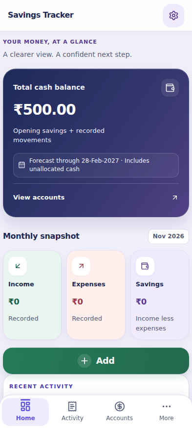
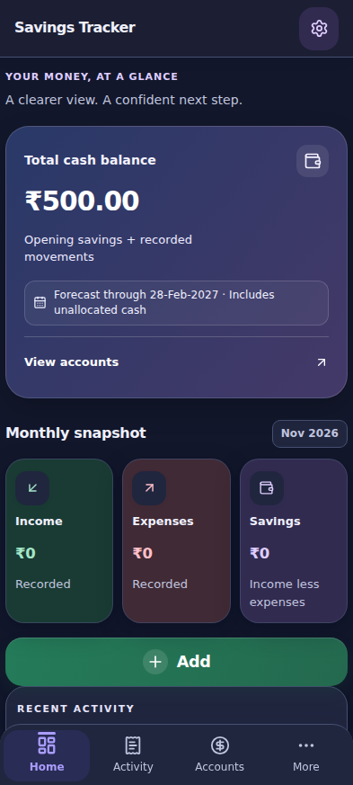
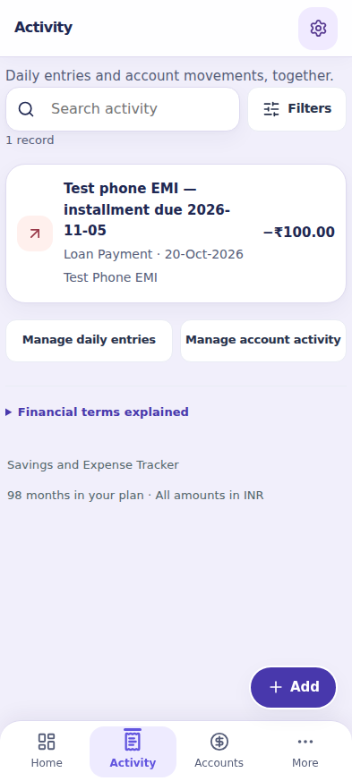
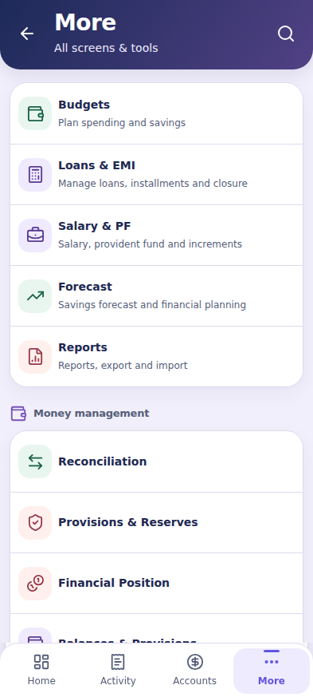

# Android-first Savings and Expense Tracker audit — 2.10.15

## A. Audit information

- **Audit/report date:** 14 November 2026, 14:40 IST. APK published **14 November 2026, 14:36:32 IST**.
- **Verified baseline main:** `b84d6713c96680ce950d4ca7d52b7e417b201ba3` (2.10.14); initial tree clean, no open PRs. Preserved its recovery, notification and background-update hardening.
- **Audit branch:** [audit/android-complete-20261114](https://github.com/nandurpm/portfolio/tree/audit/android-complete-20261114).
- **Tested fix head:** `7151689c709a7bd540ee36cd391a017be83fcfc5`. **Released merge:** `6c80d4fc8451f12892351e4ceda4d8978d7b5413`. Their Git trees were verified identical before release.
- **Published application version:** **2.10.15**, Android versionCode **21015**, app ID `com.nandakumar.savingsexpensetracker` unchanged; production signing certificate matches 2.10.14.
- **Architecture:** locally bundled React/TypeScript renderer through Capacitor 8 and Android system WebView; Java file/session/update/widget bridge. Android min API 34 (Android 14), compile/target API 36. Windows uses a separate Electron installer/preload bridge; Web uses a separate sign-in gate. No schema, production-data or signing-identity change.
- **Scope:** Android first, with shared financial/data/security regression checks and Web/Windows compatibility. Finite evidence is reported by verification level; this is not a certification of every plan, production backend setting, OEM or device.

## B. Platform audit

| Area | Review result | Build/test result | Outstanding issues |
| --- | --- | --- | --- |
| Android | Home/Activity/Accounts/More, secondary tools, insets, bridge, persistence, permissions and updater reviewed; confirmed fixes below | **PASS** signed APK build, app/version/ZIP/signature/16 KB alignment checks, certificate continuity, Android 16 install and in-place upgrade/private-marker preservation; native unit task + **9 instrumentation tests**; 27 widget screenshots | Physical devices/OEM keyboards, API 34/35 runtime and manual unknown-source installer UI **NOT TESTED** |
| Windows | Separate Electron configuration retained; shared money fixes included | **PASS** actual Windows x64 installer build and matching 2.10.15 asset; shared browser/domain parity and Electron dependency smoke | Full installed Windows GUI/update runtime on a physical PC **NOT TESTED** |
| Website | Separate signed-in Web workspace and financial parity retained | **PASS** production build, trusted manifest/bundle verification and browser regression | Production Supabase sign-in/settings **NOT TESTED**; web build is not proof of native behavior |
| Financial calculations | Income/expense, balances, paise, transfers/fees/reversals, budgets, reports, installments, salary/PF and reconciliation covered through reviewed code and synthetic suites | **313 unit tests**, including new independent rounding/high-value/date/duplicate/backup cases; 92 browser tests include cross-platform financial parity | Finite test cases; no production records used and no proof for arbitrarily extreme aggregates/plans |
| Backend/security/data | Offline revision/idempotency/conflict and backup validation; Android credential/update/permission configuration reviewed | **45 PostgreSQL checks PASS**; disposable Supabase authentication, two-user isolation, anonymous/direct-write denial, concurrency, stale-revision and password-reset checks **PASS**; npm audit **0 vulnerabilities** | Production RLS/guard parity/provider settings and real Google OAuth not verified; no standalone biometric/PIN lock added |
| UI/UX/themes | Four navigation areas retained, less duplicate UI, compact Home/Activity, all 14 More tools and light/dark support | **92 Chromium tests PASS**, including Android 320–768px, large text, keyboard/focus/modal/transfer/backup/navigation and scoped axe checks; final screenshots inspected | Browser Android simulation is distinct from the Android 16 emulator and physical-device evidence; subjective visual preference remains reviewable |

## C. Findings (RESOLVED unless explicitly deferred below)

| ID / severity | Evidence and reproduction | Root cause | Fix / files / regression |
| --- | --- | --- | --- |
| F1 — Medium, shared financial | Budget ₹1 with +0.5% produced ₹1.00 instead of ₹1.01; JavaScript `Math.round(1.005*100)/100` reproduces it. | Bulk and quick percentage adjustments bypassed the project's existing half-away-from-zero paise rule. | `src/domain/budget-adjustment.ts`, `src/pages/Budget.tsx`: use existing `roundMoney` for both paths. Seven independent expected-value cases, including negative tie, zero, −100%, and upper percentage boundary. Existing saved budgets are not rewritten. |
| F2 — Medium, shared validation | `1234567890.09` is a valid supported two-decimal amount but multiplication produces `123456789008.99998`, exceeding the fixed validation tolerance. | Ledger used absolute residual tolerance after binary multiplication rather than the shared magnitude-aware paise validator. | `src/domain/ledger.ts`: reuse `isPaise` and `toPaise`. Retain amount limit, positivity and reference/type checks. Test high opening balance, exact fee/transfer conservation, zero/negative/NaN/infinite/overflow/sub-paise rejection, same-account/duplicate rejection and dated reversal. Generated bot finance source refreshed to match; not deployed to Supabase by this audit. |
| F3 — Medium, Android / shared recent activity | Open Home → Full dashboard analysis. Both Home and embedded dashboard rendered recent activity, repeating `mobile-recent-title` and the same records. | The full dashboard component did not distinguish embedded analysis. | `AndroidDashboard222.tsx` accepts `embedded`; `AndroidHome.tsx` passes it; embedded analysis omits only the redundant recent list. Full standalone dashboard and all analysis functions remain. Browser regression asserts one recent list and no duplicate IDs. |
| F4 — Low, Android activity completeness | Existing PF contributions/claims were omitted from both Home recent activity and full Activity, though Salary & PF stores them in `pfMovements`. | Feed projections iterated only daily entries and account ledger transactions. | New `domain/activity.ts` projects the supported existing PF records as neutral movements; Home and Activity reuse it and link to Salary & PF. No change to cash/PF/income/expense calculations. Unit test checks immutability/type/amounts; browser test uses `enablePfAccount` and a real supported cash contribution. |
| F5 — Low, Android navigation/clutter | More had five fragmented groups; Reports and Import/Export navigated to exactly the same unscoped page. | Unnecessary grouping and missing import anchor. | `AndroidMore.tsx`: three cohesive groups, all 14 shortcuts retained, Import/Export targets the actual existing import heading. Existing 13-destination tests retained; new spec checks all 14 titles/group count/import destination and record preservation. |
| F6 — Low, Android Activity performance | Each ledger row resolved both account IDs by scanning the entire accounts array. | Repeated linear search, O(transactions × accounts), despite stable per-plan data. | `AndroidActivity.tsx`: construct account-name Map once per memoized activity list. Same output, fewer lookups; full existing activity/transfer suites remain. No unmeasured speed claim. |
| F7 — UI improvement, Android only | Source review found an undifferentiated balance block, repeated monthly labels and no direct balance-to-accounts action. | Weak visual hierarchy rather than an accounting issue. | `AndroidHome.tsx`, scoped `android-simple.css`: navy/indigo cash card, explicit date context, wallet accent, clear monthly heading and consistent cards; direct View accounts action; preserved existing palettes/light/dark, financial labels and four main areas. No new dependencies or fabricated comparison percentage. Browser matrices, existing accessible-rich-theme tests and screenshots required. |
| F8 — Low, native Android theme | Android bottom navigation uses `--mobile-card` (white/navy), but native system bands were sent `--sidebar-b` and navigation icons were always light. | Legacy sidebar color and fixed DARK system-bar style remained after the four-area redesign. | `App.tsx`, `native-ui.ts`: native bottom band uses Android card color on both settings and OS-theme changes; navigation icon style follows light/dark. Four mocked native-API tests cover light, dark, custom short-hex and non-Android bypass. Physical-device color behavior remains untested. |
| F9 — Low, Android layout / duplication | CI screenshots show the Activity title twice, three large history/action buttons including a duplicate Add expense, and the singular label “1 records”; tablet navigation retains default button borders and the floating Add was phone-only. | Page-local actions/title overlapped the persistent shell and phone media rules did not cover Android tablets. | `AndroidActivity.tsx`, `App.tsx`, scoped CSS: one semantic Activity heading with the visible shell title, one global Add flow on all Android widths, retain both compact history links, singular/plural counts, consistent borderless nav buttons. Browser matrix verifies Add is accessible and the duplicate is absent at 320–768px. |

### Not reproduced / deferred

- Asset daily entries and negative daily entries: neither is valid under the existing schema. An initial browser fixture exposed this and was corrected to use the supported separate PF ledger; no validation was weakened. The speculative Asset-entry classification change was removed. For negative amounts, a theoretical double-minus display was considered, but the actual schema requires positive amounts. No financial rule or sign behavior was changed for this unconfirmed case.
- Existing internal transfer neutrality is preserved; only fees count as expense. Tests cover reversal and month/date boundaries. No daily allocation added.
- More's remaining deep-link shortcuts may share a page but represent different sections; they are retained as useful functionality rather than deleted as duplicates.
- No new confirmed authentication/RLS flaw established by source review alone. Production Supabase policies/settings, real-account recovery and sync, credential rotation, personal-device lock behavior and real-device keyboard/performance need authorized environment/device evidence. Never certify them from synthetic tests.
- No broad deletion of legacy CSS: it has an established cascade and existing platform-specific overrides. Changes are scoped and verified against screenshots; a complete CSS rewrite would add regression risk.

## D. Fix implementation and regression map

| Fix | Modified application files | Regression evidence |
| --- | --- | --- |
| F1 | `domain/budget-adjustment.ts`, `pages/Budget.tsx` | `tests/android-complete-audit.test.ts`: seven explicit expected-value rounding/boundary cases |
| F2 | `domain/ledger.ts`; generated bot `finance.js` | High-value paise, invalid/duplicate/same-account rejection, transfer/fee/date/reversal/backup cases; existing conservation suites |
| F3 | `pages/AndroidDashboard222.tsx`, `pages/AndroidHome.tsx` | `tests/browser/android-complete-audit.spec.ts`: one recent list, unique IDs, preserved amounts |
| F4 | `domain/activity.ts`, `components/MobileRecentActivity.tsx`, `pages/AndroidActivity.tsx` | Immutable supported PF projection; browser validates neutral PF display, ₹500→₹475 cash with savings unchanged, and PF destination |
| F5 | `components/AndroidMore.tsx` | Existing destination tests plus 14-shortcut/group-count/import-anchor and unchanged-data checks |
| F6 | `pages/AndroidActivity.tsx` | Existing account/transfer/activity flows and responsive matrix; no unmeasured speedup claim |
| F7 / F9 | `pages/AndroidHome.tsx`, `pages/AndroidActivity.tsx`, `App.tsx`, `android-simple.css` | Light/dark, 320–768px, large-text/forms, accessibility, single Add and count checks; screenshots inspected |
| F8 | `App.tsx`, `native-ui.ts` | Four native API unit cases; Android emulator verification levels recorded separately |

Version-only manifest/lock changes and release notes accompany the fixes. No new dependencies.

## E. Verification

### Reproducible commands and outcomes

Local runtime: Node 24.22.1 / npm 11.9.0; CI uses `.nvmrc` Node 24.19.0. Commands run in `tools/tracker-source` except the versioned audit verifier below.

| Command / check | Result |
| --- | --- |
| Baseline `npm run check` | **PASS**, 49 files / 290 tests |
| Final `npm run check` | **PASS**, 51 files / **313 tests**, lint, dependency compatibility, bot finance/source parity, bot tests, quality types, web build and bundle/provenance |
| `node scripts/build-bot-finance.mjs` followed by `npm run check:bot-finance` | **PASS**; generated shared source refreshed; no Supabase function deployment |
| `npm run build:release` | **PASS**, native renderer and Electron main/preload; not itself an installer |
| `npm audit --json` / CI `npm audit` | **PASS**, zero vulnerabilities at audit time |
| `npx cap sync android` | **PASS** |
| Local `bash android/gradlew -p android --no-daemon assembleDebug` | **BLOCKED**, Gradle download: `java.net.SocketException: Network is unreachable` for services.gradle.org; not counted as PASS |
| CI `npm run test:browser` | **PASS**, **92/92**, final head `7151689c709a7bd540ee36cd391a017be83fcfc5` |
| CI `npm run test:database` | **PASS**, **45 checks**, PostgreSQL 17.12, two synthetic identities, real concurrent sessions; copied policies/RPC plus proposed guard; production untouched |
| CI `npm run test:security` and local password-reset script | **PASS**, real disposable local Supabase HTTP/Auth stack; Google/provider production flows separate |
| CI `npm run test:dependencies` | **PASS**, including actual Electron/native packaging compatibility; no user records/keys used for PR smoke |
| CI `bash ./gradlew --no-daemon assembleDebug testDebugUnitTest assembleReleaseAndroidTest` | **PASS**, actual Android project compilation/unit tests/instrumentation APK assembly |
| CI `npm run dist:win` | **PASS**, real Windows installer, not physical-PC GUI testing |
| Release `npm run android:release` | **PASS**, production-signed 2.10.15 APK, existing authorized identity |
| `apksigner verify --verbose --print-certs`, API 34–36 signature check, `zipalign -c -P 16 4`, `aapt dump badging` | **PASS**; matching app ID, version and previous APK certificate |
| `adb install` prior APK then `adb install -r` current APK; `am start -W` | **PASS** on isolated Android 16 emulator; app launch OK, private marker survived upgrade |
| `bash gradlew :app:testReleaseUnitTest :app:connectedReleaseAndroidTest` | **PASS**; connected XML confirms **9 tests / 0 failures / 0 errors**, including native window clearance and widget behavior; repeat rendering/separate-process checks also PASS |
| `git diff --check` | **PASS** |
| Download public APK and `SHA256SUMS.txt` using `curl -fLsS` | **PASS**; actual downloaded APK is **9,830,746 bytes** and SHA-256 matches both checksum file and GitHub asset digest |
| `python docs/audit/verify-android-2.10.15.py /path/to/Savings-and-Expense-Tracker-2.10.15.apk` | **PASS** against the downloaded APK: ZIP CRC, clean release manifest, version/source commit, **57 bundled file checksums**, no mismatches |
| `latestTrackerUpdate` with actual published release JSON and installed `2.10.14` | **PASS**: Android and Windows both select 2.10.15; confirms metadata-based detection, not manual device installer interaction |

### CI and native evidence

- [Final quality run 43577852896](https://github.com/nandurpm/portfolio/actions/runs/43577852896): **all six jobs PASS**. Browser screenshots retained in `tracker-synthetic-browser-results`.
- [Release run 43578373501](https://github.com/nandurpm/portfolio/actions/runs/43578373501): **all five jobs PASS**, including publish.
- Native artifact: `tracker-android-tests-6c80d4fc8451f12892351e4ceda4d8978d7b5413`. Connected report lists one SystemBarClearance test and eight Widgets tests. Evidence contains **27 synthetic widget screenshots plus one installation screenshot**. A marker surviving upgrade does not establish every user's financial-record migration.
- Downloaded APK manifest: version 2.10.15, mode `release`, dirty `false`, source commit `6c80d4fc8451f12892351e4ceda4d8978d7b5413`; financial logic SHA-256 `d0fc75b6f91d6fcb06dd0a79bfa797b59c90ea29db01e6ffd1493678a8b093ce`, data-model SHA-256 `9e05f646c1a6a7ae8e51c12263b8231016938bcfaa81445c07c3a7ec5b6c2852`.

Earlier test failures are retained transparently: an unsupported Asset-entry fixture was correctly rejected, so the speculative classification change was removed and replaced with a supported PF contribution; a later assertion compared rendered block text to textContent rather than the amount, and was corrected to compare the savings amount directly. No validation, feature or assertion requirement was weakened. The corrected final run passes all tests.

Verification levels: **static review PASS within described scope; automated domain/browser/disposable-backend tests PASS; production builds PASS; Android 16 emulator PASS within described tests; physical device NOT TESTED**. Local Chromium/Gradle environment limits were handled through CI, not represented as local execution. No Nu/Lighthouse score, universal financial correctness, real production RLS certification or end-to-end Google OAuth claim.

## F. GitHub and release status

- [Fix PR #143](https://github.com/nandurpm/portfolio/pull/143): **MERGED**, under the user's explicit fix-and-release instruction.
- [Audit branch](https://github.com/nandurpm/portfolio/tree/audit/android-complete-20261114), [tested fix commit](https://github.com/nandurpm/portfolio/commit/7151689c709a7bd540ee36cd391a017be83fcfc5), [released merge commit](https://github.com/nandurpm/portfolio/commit/6c80d4fc8451f12892351e4ceda4d8978d7b5413). Baseline was verified unchanged before merge; no unrelated work reset or discarded.
- [Release tracker-v2.10.15](https://github.com/nandurpm/portfolio/releases/tag/tracker-v2.10.15): **PUBLISHED**, not a draft/prerelease. Existing application ID and signing identity retained. App versionCode 21015 is newer than 21014.
- [Change log](../../tools/tracker-source/CHANGELOG-2.10.15.md). The report-evidence follow-up changes documentation/screenshots only; it does not alter the released application payload.

| Published asset | Bytes | SHA-256 |
| --- | ---: | --- |
| [Savings-and-Expense-Tracker-2.10.15-Source.zip](https://github.com/nandurpm/portfolio/releases/download/tracker-v2.10.15/Savings-and-Expense-Tracker-2.10.15-Source.zip) | 1,234,531 | `7cd15c7baabf04dc6ab3637fe26c980cb2c80e993c80c839e7bbb9ce9d25f134` |
| [Savings-and-Expense-Tracker-2.10.15.apk](https://github.com/nandurpm/portfolio/releases/download/tracker-v2.10.15/Savings-and-Expense-Tracker-2.10.15.apk) | 9,830,746 | `b8dd61988720ef8979f994de15fcbff579214beaf3232a875009f1cc3566c45e` |
| [Savings-and-Expense-Tracker-Setup-2.10.15.exe](https://github.com/nandurpm/portfolio/releases/download/tracker-v2.10.15/Savings-and-Expense-Tracker-Setup-2.10.15.exe) | 116,280,581 | `3354123880dd6f684fc3a0060b6fb97b08dc20da67b9c3524b567b9ede19c717` |

The release also contains `SHA256SUMS.txt` and the change log. Update over the existing APK rather than uninstalling to retain app-private data; Android still requires the normal installer permission/confirmation. No OTA path or signing replacement introduced. No owner software-update notification was requested or dispatched by this run.

## G. Outstanding risks and limits

- **NOT TESTED:** physical Android phones/tablets, OEM WebView/keyboard variations, API 34/35 runtime, real user cold-start speed, and manual unknown-source installer UI. API 36 compilation/signature checks/emulation do not prove those behaviors.
- **NOT TESTED:** a fully installed Windows GUI/update on a physical PC. Installer build and shared renderer tests are separate evidence.
- **DEFERRED:** production Supabase RLS/guard/provider/auth settings and real Google OAuth need authorized production configuration review. The proposed optional-field guard remains unapplied. No destructive migration or production record change occurred.
- **POTENTIAL:** compressed workbook imports retain existing 10 MB input bounds, but decompression resource exhaustion was not stress-tested. No crash/security exploit is claimed from source suspicion alone.
- **LIMITATION:** no separate biometric/PIN app lock was established in reviewed source; local plans/exports are not claimed to be end-to-end encrypted. Device lock, app sandbox and careful backup handling remain relevant. A new lock needs a recovery/lockout design.
- **LIMITATION:** finite deterministic/randomized/synthetic tests cannot prove every plan, all rounding aggregates, lender-specific irregular schedules or production records. Existing schedule rules/settings were preserved; no missing financial rule or transaction was invented.
- **DEFERRED:** wholesale legacy CSS removal and unrelated redesign. Confirmed duplicate UI was removed while useful destinations, supported accounting, data models, backups and user palette settings remain.

No known failing applicable check remains on the published release. This statement is scoped to the executed checks above, not a claim of universal correctness or security.

## Detailed review boundaries

- **Startup/navigation/performance:** local bundled renderer (no remote app URL), cached lazy page loading, deferred chart/analysis mounting, minute/date refresh, Android Back/save-before-exit, four main destinations, nested dialog stack, insets handled natively. Existing 288-month/1,000-entry browser benchmark is retained; measurements describe CI simulation, not this owner's device. No new animation/heavy asset dependency.
- **Financial rules:** ledger postings use paise and validate distinct accounts, IDs, supported account kinds, bounded refunds and one reversal per original. Salary/PF and loan schedules remain separate; tests exercise plan/calendar boundaries, partial payments, employment/PF, reconciliation, reserves and import consistency. No balances or missing transactions are invented. Transfers affect named balances but not principal income/expense; fees reverse with the original.
- **Persistence/backup/import:** app-private native files, bounded reads and recovery preserved from 2.10.14; JSON envelope validation and stable-ID undo/redo safeguards; offline cache preservation, revision/identity-based sync retry and manual conflict review. XML/ZIP imports retain the existing 10 MB compressed-file bound. Decompressed archive resource exhaustion was not stress-tested; record this as POTENTIAL further hardening, not a reproduced crash.
- **Security/authentication:** Android Keystore AES-GCM session storage, session-key allowlist, PKCE/OAuth callback validation, no bridge logging or release WebView debugging, cleartext/mixed content disabled. Permission review found INTERNET, VIBRATE, POST_NOTIFICATIONS and REQUEST_INSTALL_PACKAGES; no contacts, SMS or broad storage permission. SAF handles selected import/export files. Local financial plan files/exports are not claimed to be end-to-end encrypted. No separate biometric/PIN app-lock implementation was established; Android device lock/sandbox remains important. No new lock feature is added without recovery/lockout design.
- **Updates:** fixed official repository/tag/version asset URLs, uploaded nonempty asset/digest requirements, size bound, native APK verification and preserved production signing. Release CI compares certificate to the prior APK and tests install-over-existing rather than replacing identity. Offline notification/update retry logic from 2.10.14 remains. An in-app update still requires Android's installer permission/confirmation.
- **Platform gaps:** API 34/35 and OEM devices require separate testing; API 36 emulator coverage does not cover them automatically. Supabase fixtures establish disposable-stack behavior only, not production RLS parity or provider settings. Proposed optional-field guard SQL is not applied by this audit.

## Android design system and screen hierarchy

| Area | Retained / improved hierarchy |
| --- | --- |
| Home | Cash balance (not net worth), reporting date, selected-month summary, one Add flow, recent activity, expandable full analysis |
| Activity | Search and filter sheet; daily/account/PF activity; two compact history-management links; one global Add action |
| Accounts | Existing creation/edit/archive/types/openings/liabilities/investments/FD/cards, transfer sheet, activity, reconciliation and position |
| More | Main tools; Money management; App & Data. All 14 existing shortcuts retained, including forecasts, reports, budgets, loans/EMI, Salary/PF, reserves, settings, backup/restore, import/export, cloud and help |

Android uses existing scoped mobile tokens: soft lavender/light and navy/dark backgrounds, white/dark cards, indigo cash hierarchy, semantic green income, coral expense, purple movement; labels distinguish meaning beyond color. Buttons/inputs remain at least 48px and bottom-nav targets at least 56px. Existing palettes, font scaling, focus styles and native inset ownership remain. No extra bitmap/animation dependency or unrelated redesign. Screenshot amounts are synthetic fixtures.

### Verified browser screenshots

| Home · light | Home · dark |
| --- | --- |
|  |  |

| Activity | More |
| --- | --- |
|  |  |
